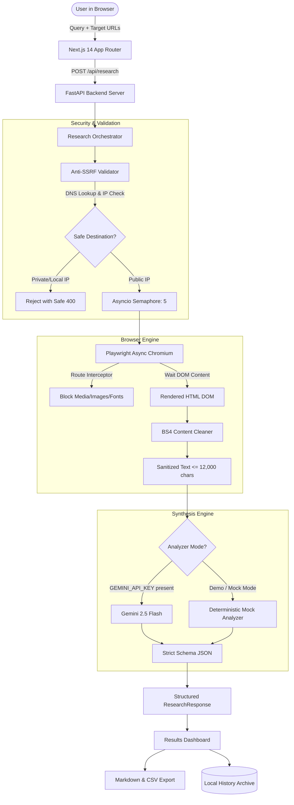

# WebScout — AI-Powered Multi-Website Research Agent
> **wHACKiest 2026 Hackathon • Track 2: Web Agents & Automation**

[-black?logo=next.js)](https://nextjs.org/)
[](https://fastapi.tiangolo.com/)
[](https://playwright.dev/)
[](https://deepmind.google/technologies/gemini/)
[](https://www.typescriptlang.org/)
[](https://www.python.org/)

---

## 1. Problem Statement

Conducting multi-source online research is painfully manual:
- Users open dozens of browser tabs across competitor websites, forums, technical teardowns, and benchmark archives.
- Critical specifications and conflicting claims are scattered across inconsistent page layouts and bloated marketing fluff.
- Traditional search engines return links rather than syntheses, while standard AI chatbots cannot reliably browse multi-page dynamic DOMs or supply verifiable source citations.

---

## 2. The Solution: WebScout

**WebScout** is an autonomous multi-website research agent. Users formulate a research question and supply 1 to 5 target websites. WebScout autonomously navigates the target websites in parallel using headless Chromium, strips ads and navigation noise, evaluates extracted content against the query using Gemini, and produces an authoritative comparative matrix with pros, cons, and verifiable citations.

---

## 3. Key Capabilities

- **Concurrent Multi-Website Navigation**: Visits up to 5 public websites concurrently using asynchronous headless Chromium via Playwright.
- **Deep Anti-SSRF & Network Security**: Strict scheme validation (HTTP/HTTPS only), standard ports only (80/443), private IP and localhost blocking, cloud metadata (`169.254.169.254`) protection, and runtime Playwright route interception.
- **Semantic DOM Sanitization**: BeautifulSoup4 cleans ads, modals, cookie popups, and scripts, extracting structured headings, tables, and paragraphs capped at 12,000 characters per page.
- **Dynamic Comparative Matrix**: Comparison dimensions are generated dynamically from source findings rather than hardcoded tables.
- **Verifiable AI Recommendation**: Clearly identifies the top choice backed by cited source links and technical rationale.
- **Export Formats**: One-click **Copy as Markdown** (escaped table cells, structured hierarchy) and **Download CSV** (UTF-8 BOM for immediate Excel compatibility).
- **Private Browser Archive**: Saves research dossiers locally using browser `localStorage` (`webscout_history_v1`) with full session reopening.
- **Predictable Demo Mode**: Built-in mock engine (`USE_MOCK=true`) for 100% dependable live hackathon presentations regardless of third-party network conditions.

---

## 4. Architecture Overview



---

## 5. Project Directory Structure

```
WebScout/
├── frontend/                       # Next.js App Router Frontend
│   ├── app/
│   │   ├── layout.tsx              # Root HTML layout with ThemeProvider
│   │   ├── page.tsx                # SaaS Landing Page
│   │   ├── research/
│   │   │   ├── page.tsx            # Research Setup Workspace
│   │   │   └── results/page.tsx    # Live Loading, Results Dashboard & History Viewer
│   │   └── history/page.tsx        # Saved Research Archive Page
│   ├── components/
│   │   ├── landing/                # Hero, Features, How It Works, Competitor Comparison
│   │   ├── layout/                 # Sticky Navbar, ThemeToggle, Footer
│   │   ├── research/               # Matrix, ExecutiveSummary, RecommendationCard, ResultsActions
│   │   └── history/                # HistoryCard, HistoryList, ClearHistoryDialog
│   ├── lib/
│   │   ├── api.ts                  # Centralized API client with 90s timeout & abort control
│   │   ├── storage.ts              # LocalStorage manager (20-entry FIFO, error recovery)
│   │   ├── export.ts               # Clean Markdown & CSV Blob exporters (UTF-8 BOM)
│   │   └── validation.ts           # URL and query form validation helpers
│   ├── package.json
│   └── .env.example
├── backend/                        # FastAPI Python Backend
│   ├── app/
│   │   ├── main.py                 # FastAPI application, lifespan browser management, CORS
│   │   ├── config.py               # Pydantic Settings configuration
│   │   ├── api/routes/
│   │   │   ├── health.py           # GET /api/health
│   │   │   └── research.py         # POST /api/research
│   │   ├── models/                 # Request, Response, and Fetch Pydantic schemas
│   │   ├── services/
│   │   │   ├── fetchers/           # Playwright Chromium and Mock fetchers
│   │   │   ├── analyzers/          # Gemini 2.5 Flash and Mock analyzers
│   │   │   └── orchestrator.py     # Concurrent task coordinator (Semaphore=5)
│   │   └── utils/
│   │       ├── url_validation.py   # Strict anti-SSRF IP and DNS security engine
│   │       └── content_cleaner.py  # BeautifulSoup4 HTML cleaner & 12k char cap
│   ├── tests/                      # 19 automated Pytest tests + E2E integration test
│   ├── requirements.txt            # Python dependencies
│   ├── pytest.ini
│   └── .env.example
├── README.md                       # Master Documentation
└── .gitignore                      # Strictly excludes .env, .venv/, credentials
```

---

## 6. Installation & Prerequisites

### Prerequisites
- **Node.js**: v18.17.0 or newer
- **Python**: v3.11 or newer

### 1. Backend Setup
```bash
cd backend
python -m venv .venv
# Windows:
.\.venv\Scripts\activate
# macOS/Linux:
source .venv/bin/activate

pip install -r requirements.txt
playwright install chromium
```

### 2. Frontend Setup
```bash
cd frontend
npm install
```

---

## 7. Environment Configuration

### Frontend (`frontend/.env.local`)
```env
# Leave empty so all /api/* requests route seamlessly through http://localhost:3000
NEXT_PUBLIC_API_URL=
BACKEND_INTERNAL_URL=http://127.0.0.1:8000
```

### Backend (`backend/.env`)
```env
PROJECT_NAME="WebScout API"
VERSION="0.1.0"
DEBUG=true

# Engine Options
FETCHER=playwright     # 'playwright' or 'mock'
ANALYZER=auto          # 'auto' (uses Gemini when GEMINI_API_KEY is set), 'gemini', or 'mock'
USE_MOCK=false         # Set to true for 100% offline demo mode
MAX_URLS=5

# Google Gemini API Key (Required only for real Gemini synthesis)
GEMINI_API_KEY=your_gemini_api_key_here

# Allowed CORS Origins
CORS_ORIGINS=http://localhost:3000
```

---

## 8. Running the Application

### Single-Command Unified Startup (Recommended)
From the project root:
```bash
npm run dev
```
This launches the FastAPI + Playwright backend internally on `127.0.0.1:8000` and the Next.js frontend at **[http://localhost:3000](http://localhost:3000)** with same-origin `/api/*` proxying built in. Open **[http://localhost:3000](http://localhost:3000)** in your browser.

For production mode (after `npm run build`):
```bash
npm start
```

### Option B: 100% Offline Hackathon Demo Mode
Set `USE_MOCK=true` in `backend/.env` or start with:
```bash
# Windows PowerShell:
$env:USE_MOCK="true"; uvicorn app.main:app --port 8000 --app-dir backend --host 0.0.0.0
```
WebScout runs deterministically using simulated sources without requiring internet access or API credits. The UI visibly flags the run with a `PREDICTABLE DEMO MODE` badge.

---

## 9. API Reference

### Health Probe
`GET /api/health`
```json
{
  "status": "ok",
  "service": "WebScout API",
  "version": "0.1.0",
  "fetcher": "playwright",
  "analyzer": "mock"
}
```

### Research Endpoint
`POST /api/research`
```json
{
  "query": "Best laptops for computer engineering students under $1500",
  "urls": [
    "https://example.com/macbook-air",
    "https://example.org/dell-xps-13"
  ]
}
```

**Response Format:**
```json
{
  "query": "Best laptops for computer engineering students under $1500",
  "summary": "Detailed multi-source comparative synthesis...",
  "criteria": ["Battery Longevity", "Processor & RAM", "Portability", "Price Range"],
  "items": [
    {
      "name": "Apple MacBook Air 13\" (M3)",
      "source_url": "https://example.com/macbook-air",
      "values": {
        "Battery Longevity": "15-18 hours",
        "Processor & RAM": "M3 (8-core CPU), 16GB Unified RAM"
      },
      "pros": ["Silent fanless operation", "Industry-leading battery efficiency"],
      "cons": ["Limited to 2 external displays"]
    }
  ],
  "recommendation": {
    "winner": "Apple MacBook Air 13\" (M3)",
    "reasoning": "Unmatched battery efficiency and sustained performance for developer workloads.",
    "source_urls": ["https://example.com/macbook-air"]
  },
  "sources": [
    {
      "url": "https://example.com/macbook-air",
      "title": "MacBook Air Review",
      "status": "ok",
      "error": null
    }
  ],
  "elapsed_ms": 1840
}
```

---

## 10. Security & Anti-SSRF Protections

1. **Protocols**: Only `http://` and `https://` are permitted.
2. **Ports**: Only standard ports `80` and `443` are allowed. Non-standard ports (`22`, `3000`, `8000`, `8080`, `6379`) are blocked.
3. **Restricted IP Blocking**: Direct access or DNS resolution pointing to `127.0.0.1`, `localhost`, `10.0.0.0/8`, `172.16.0.0/12`, `192.168.0.0/16`, `fc00::/7`, or Cloud Metadata `169.254.169.254` is strictly rejected before opening any browser page.
4. **Subrequest Guarding**: Playwright intercepts all navigation requests and redirects via `page.route("**/*")`. If a script or redirect attempts to navigate to a restricted IP, it is aborted with `blockedbyclient`.
5. **Anti-Prompt-Injection**: Extracted webpage content is wrapped in `<untrusted_website_content>` tags with strict system instructions preventing webpage text from hijacking LLM instructions.

---

## 11. Testing & Verification

### Run Backend Unit & Integration Tests
```bash
python -m pytest backend/tests -v
```
All **19 tests** pass in ~1.4 seconds.

### Run End-to-End Multi-Website Test
```bash
python backend/tests/e2e_integration_test.py
```
Tests concurrent headless browser retrieval against live public websites (`example.com`, `wikipedia.org`).

### Run Frontend Typecheck & Build
```bash
cd frontend
npm run typecheck
npm run build
```

---

## 12. Hackathon Live Demonstration Walkthrough

1. **Problem Intro (30s)**: Open [http://localhost:3000](http://localhost:3000). Highlight the friction of opening dozens of product tabs and manually compiling comparison notes.
2. **Research Query (30s)**: Click **Start researching** &rarr; Select an example chip (or enter `"Best lightweight developer laptops in 2026"`) with 3 real URLs.
3. **Execution & Honest Loading (30s)**: Click **Start researching**. Point out the honest indeterminate engine status showing Playwright Chromium exploring target domains concurrently.
4. **Results Dashboard (45s)**: Inspect the synthesized **Executive Summary**, the verified **AI Recommendation**, the dynamic **Comparative Matrix**, and the granular **Pros & Cons**.
5. **Export & History (30s)**: Demonstrate **Copy as Markdown**, **Download CSV**, open **/history**, and reopen the saved session instantly.
6. **Architecture (15s)**: Show the modular Next.js &rarr; FastAPI &rarr; Playwright &rarr; Gemini pipeline.
