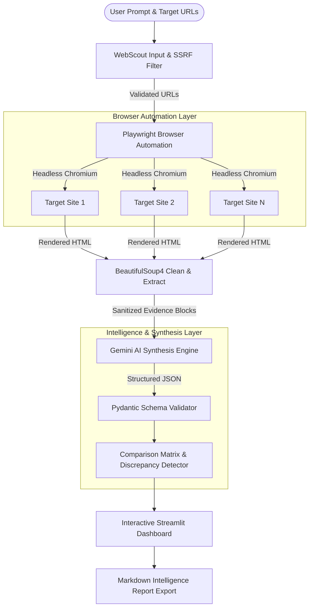

# WebScout 🌐
> **"Research smarter. Compare faster. Decide confidently."**  
> An AI-Powered Autonomous Multi-Website Research & Intelligence Agent.

---

## 📌 1. Product Vision & Problem Statement

### The Problem
Modern online research is fragmented and time-consuming:
- Students and researchers must open dozens of browser tabs, manually skim long articles, filter out sponsored ads, and synthesize notes.
- Consumers comparing laptops, cloud providers, or technical frameworks must reconcile conflicting specifications and marketing fluff across divergent sources.
- Conventional search engines merely provide a list of search links, leaving the research workload on the user.
- Typical AI chatbots hallucinate ungrounded summaries without active live web navigation or verifiable citations.

### Our Solution
**WebScout** is an autonomous browser-driven research agent that:
1. Understands complex natural language research questions.
2. Autonomously navigates multiple live target websites using **Playwright (Headless Chromium)**.
3. Cleans dynamic DOM trees and removes noise with **BeautifulSoup4**.
4. Cross-examines collected evidence, detects discrepancies, and reconciles conflicting claims.
5. Employs the **Google Gemini API** (`google-genai` SDK) to generate structured comparisons, transparent evidence citations, and decisive, actionable recommendations.

---

## 🚀 2. Core Features

- 🎯 **Intelligent Research Input**: Natural-language query validation, multi-URL parsing, and custom evaluation criteria (e.g. price, performance, developer ecosystem).
- 🛡️ **SSRF & Anti-Prompt-Injection Safeguards**: Enforces public HTTP/HTTPS URLs only, blocks loopback/localhost and private CIDR ranges, and quarantines scraped content within untrusted data delimiters.
- 🤖 **Autonomous Browser Navigation**: Real-time headless Chromium execution using Playwright; handles dynamic client-side hydration, custom user-agent headers, and per-site error handling so a single failed site never halts research.
- 🧹 **Semantic DOM Extraction**: Strips scripts, styles, navigation bars, footers, advertisements, and cookie banners with BeautifulSoup4.
- 🧠 **Google Gemini AI Engine**: Powered by the official `google-genai` SDK with strict **Pydantic v2** structured JSON schema enforcement.
- ⚖️ **Cross-Source Comparison Matrix**: Dynamically generates comparison tables tailored to the research topic.
- ⚡ **Contradiction & Discrepancy Detection**: Identifies and flags conflicting claims across sources without arbitrarily guessing truth.
- 📄 **Verifiable Source Grounding**: Every finding includes exact extracted text excerpts and direct links to the original live website.
- 📥 **One-Click Intelligence Report Export**: Exports complete research dossiers to Markdown (`.md`) for note-taking and documentation.
- 💡 **Heuristic Fallback Engine**: If no Gemini API key is configured or offline, WebScout gracefully switches to built-in semantic extraction so users never face a crash.

---

## 🏛️ 3. System Architecture



---

## 💻 4. Technology Stack

| Component | Technology | Description |
| :--- | :--- | :--- |
| **Frontend UI** | `Streamlit 1.39+` | Modern responsive research dashboard with custom design tokens |
| **Browser Automation** | `Playwright 1.48+` | Headless Chromium browser automation engine |
| **Content Extraction** | `BeautifulSoup4 + lxml` | Semantic HTML parsing, tag decomposition, and noise removal |
| **Generative AI** | `google-genai` SDK | Google Gemini API (Gemini 2.5 Flash / Gemini 2.0 Flash) |
| **Data Validation** | `Pydantic v2` | Strict JSON schema generation and verification |
| **Data Processing** | `Pandas` | Dataframe manipulation for comparative matrix tables |
| **Environment** | `python-dotenv` | Secure local credential management |

---

## 📁 5. Project Directory Structure

```
WebScout/
│
├── app.py                 # Streamlit frontend dashboard & interactive workflow
├── scraper.py             # Playwright browser manager & BeautifulSoup4 extractor
├── ai_engine.py           # Google Gemini SDK integration & Pydantic schema validation
├── analyzer.py            # Research session orchestrator & milestone pipeline
├── utils.py               # SSRF security filter, input validation & markdown exporter
├── test_suite.py          # Comprehensive QA and verification test suite
│
├── requirements.txt       # Production dependencies
├── .env.example           # Environment template with placeholders
├── .gitignore             # Git exclusion rules (safeguards .env and virtualenvs)
├── README.md              # Master product documentation
│
└── assets/
    └── logo.png           # Typographic brand mark and icon
```

---

## ⚙️ 6. Installation & Setup Instructions (Windows & Cross-Platform)

### Prerequisites
- Python **3.10 to 3.13** installed.
- Internet access to download Playwright Chromium binaries and contact the Gemini API.

### Step 1: Clone or Navigate to the Workspace
```powershell
cd "c:\Users\Yogeshwari S\Desktop\WebScout"
```

### Step 2: Create and Activate Virtual Environment
```powershell
# Windows
py -m venv .venv
.\.venv\Scripts\Activate.ps1

# macOS / Linux
python3 -m venv .venv
source .venv/bin/activate
```

### Step 3: Install Required Dependencies
```powershell
pip install -r requirements.txt
```

### Step 4: Install Playwright Chromium Browser
```powershell
playwright install chromium
```

### Step 5: Configure Environment Variables
Copy `.env.example` to `.env`:
```powershell
Copy-Item .env.example .env
```
Open `.env` and add your Google Gemini API key:
```env
GEMINI_API_KEY=AIzaSy...your_actual_key_here
```
> *Tip: You can obtain a free Gemini API key from [Google AI Studio](https://aistudio.google.com/). You can also input the key directly inside the Streamlit app sidebar!*

---

## 🚀 7. Running the Application

Launch the Streamlit dashboard:
```powershell
streamlit run app.py
```
Open your browser at `http://localhost:8501`.

---

## 🧪 8. Automated Verification & QA Results

WebScout includes a comprehensive automated test suite in `test_suite.py` that verifies:
1. URL format validation (HTTP/HTTPS acceptance).
2. SSRF, localhost, and private IP blocks (127.0.0.1, 192.168.1.1, 10.0.0.1, 169.254.x).
3. Research query input constraints (minimum 2 distinct URLs, valid question).
4. BeautifulSoup HTML stripping of cookie banners, scripts, ads, and footers.
5. Live Playwright headless Chromium navigation and DOM rendering.
6. Error resilience on dead or unreachable domains.
7. AI response cleaning and strict Pydantic v2 JSON schema validation.
8. End-to-end multi-site research session orchestration.

### Running the Test Suite:
```powershell
python test_suite.py
```

### Verified Test Output:
```
test_01_url_validation_allowed ... ok
test_02_url_validation_blocked_schemes_and_ssrf ... ok
test_03_research_inputs_enforcement ... ok
test_04_bs4_html_cleaning ... ok
test_05_playwright_real_navigation ... ok
test_06_playwright_failure_tolerance ... ok
test_07_ai_response_cleaning_and_pydantic_validation ... ok
test_08_end_to_end_research_session ... ok

----------------------------------------------------------------------
Ran 8 tests in 13.755s

OK
```

---

## ⚠️ 9. Known Limitations

- **Anti-Bot Gated Websites**: Some websites protected by advanced Cloudflare Turnstile or CAPTCHA challenges may block automated headless browsers; WebScout flags these as `BLOCKED` or `PARTIAL` and completes the research using the remaining sources.
- **Paywalled Sites**: Pages requiring a subscriber login cannot be scraped without credentials.
- **Single Page Depth**: Currently navigates the specific URLs provided rather than recursively crawling deep site hierarchies.

---

## 🗺️ 10. Future Development Roadmap

- 🔍 **Automated Source Discovery**: Integrate search engines (SerpAPI / Google Custom Search) to automatically discover candidate URLs based on the query.
- 🕸️ **Deep Multi-Page Crawling**: Allow the agent to follow internal hyperlinks within a domain to gather secondary corroboration.
- 💾 **Persistent Research Workspace**: Store previous research sessions in SQLite / PostgreSQL with search history and bookmarking.
- 📊 **Export Formats**: Add PDF report export with visual charts and branded executive layouts.
- 🎙️ **Voice-Driven Research**: Natural speech-to-text querying and audio brief generation.
- ☁️ **Cloud Deployment**: Containerized Docker image and AWS ECS / Google Cloud Run deployment templates.

---

## 🛡️ 11. Security & Responsible AI

- **No Hardcoded Keys**: API keys are loaded via `.env` or temporary session input; `.gitignore` guarantees secrets are excluded from Git commits.
- **Strict Evidence Boundaries**: Extracted text from third-party websites is treated as untrusted data. Explicit anti-prompt-injection system instructions prevent web content from hijacking agent directives.

---

**WebScout — Research smarter. Compare faster. Decide confidently.**
